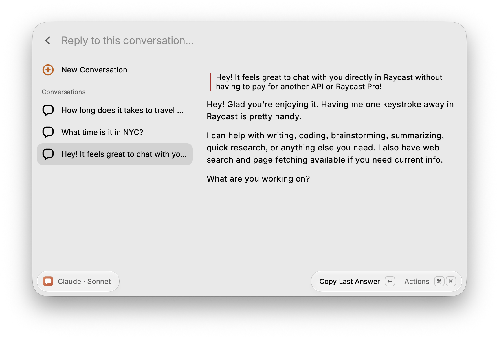
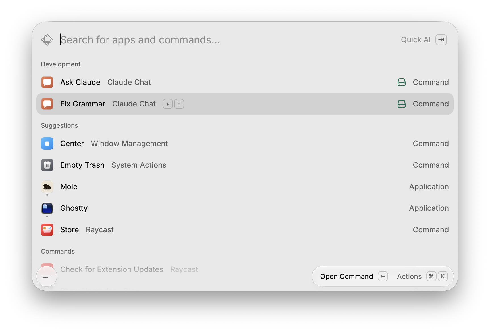
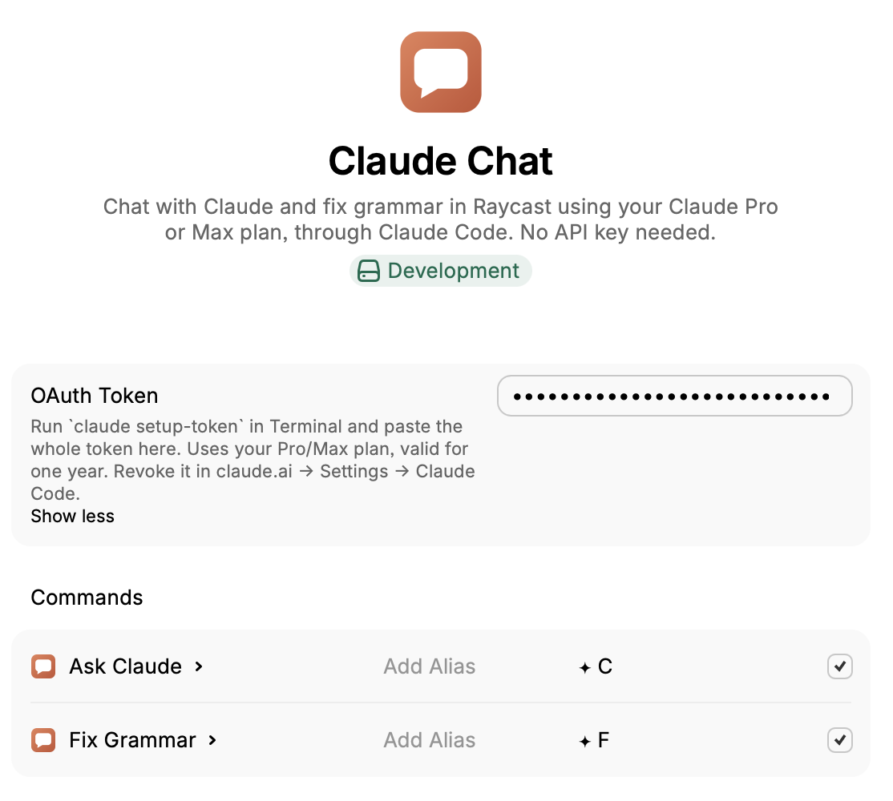

<p align="center"></p>

# Claude Chat for Raycast

Chat with Claude from Raycast on your **Claude Pro or Max subscription**, without an API key.
The extension runs the official [Claude Code](https://code.claude.com) CLI in headless mode (`claude -p`), so usage counts toward your plan's limits, never per-token API billing.

> [!IMPORTANT]
> This is an unofficial extension and it isn't published on the Raycast Store, where it would most likely be rejected: it lets you chat with Claude without an API key or a Raycast Pro subscription, and its Fix Grammar command recreates Raycast's own Fix Spelling and Grammar AI command. It works with a free Raycast account.



## Commands

- **Ask Claude**: a chat with your conversation history. Conversations are listed on the left, the selected one on the right (latest exchange first). Type in the search bar and press `↵`. Web search is available.
  `⌘N` new conversation · `⌘.` stop · `⌘⇧C` copy the conversation · `⌘⇧V` paste the last answer · `⌃X` delete the conversation.
- **Fix Grammar**: select text in any app and run the command (give it a hotkey). The corrected text replaces the selection without opening Raycast, in about a second. It uses Raycast's own Fix Spelling and Grammar prompt, with Haiku by default.



## Requirements

- macOS with [Raycast](https://raycast.com)
- [Node.js](https://nodejs.org) 22 or later
- A Claude Pro or Max subscription
- Claude Code: `brew install --cask claude-code`

## Install

```bash
git clone https://github.com/mickaphd/raycast-claude-chat.git
cd raycast-claude-chat
npm install && npm run dev
```

`npm run dev` registers the extension in Raycast. Once it prints `ready`, stop it with `Ctrl+C`: the extension stays installed. After pulling updates, run `npm run build`.

Then create a long-lived token tied to your subscription and paste it in the extension's **OAuth Token** preference:

```bash
claude setup-token
```

Approve access in the browser and copy the whole `sk-ant-oat01-…` token (some terminals add spaces when copying; they are stripped). The token is valid for one year and can be revoked in claude.ai → Settings → Claude Code → Authorization tokens. Raycast stores it encrypted; it never leaves your Mac except to authenticate with Anthropic.

<p align="center"></p>

## How it works

- Each message spawns `claude -p --output-format stream-json` and streams the answer into Raycast. Context is kept with `--resume <session_id>`; if Claude Code has deleted the session, the history is replayed in the prompt.
- Claude Code's file and shell tools, settings, hooks, MCP servers and system prompt are disabled or replaced, so it behaves as a plain assistant. Only web search and web fetch stay available in the chat; Fix Grammar has no tools at all.
- Telemetry, error reporting, update checks and claude.ai connector lookups are turned off, and any `ANTHROPIC_API_KEY`, auth token or custom endpoint is removed from the environment: each message is a single request to Anthropic, plus the web pages Claude fetches when a question needs them.
- Conversations are stored locally in Raycast. Claude Code also keeps chat sessions in `~/.claude/projects/`; Fix Grammar keeps nothing.

## Uninstall

1. In Raycast, open **Settings → Extensions**, right-click **Claude Chat** and choose **Uninstall**. This also deletes its conversations and preferences, including the token.
2. Revoke the token in claude.ai → Settings → Claude Code → Authorization tokens (the row with only the `user:inference` scope).
3. Optionally, delete the chat sessions Claude Code kept on disk:

   ```bash
   rm -rf ~/.claude/projects/*com-raycast-macos-extensions-claude-code-chat
   ```

4. Delete the cloned `raycast-claude-chat` folder.

## License

MIT
